# 상식 퀴즈 게임

Python 3.10 이상에서 실행하는 터미널 퀴즈 게임입니다. 메뉴에서 문제를 풀거나 새 문제를 등록하고, 목록과 최고 점수를 확인할 수 있습니다.

## 퀴즈 주제와 선정 이유

수도, 요일, 자연 현상, 도형처럼 누구나 쉽게 풀 수 있는 **기초 상식**을 주제로 골랐습니다. 특별한 배경지식 없이 입력과 결과 확인에 집중할 수 있도록 기본 문제 7개를 넣었습니다.

## 실행 방법

외부 라이브러리는 필요하지 않습니다. 이 폴더에서 다음 명령을 실행하세요.

```powershell
python main.py
```

Python 설치 환경에 따라 `py main.py`를 사용할 수도 있습니다. 메뉴에서 1~5를 입력합니다. 숫자 앞뒤의 공백은 무시하며, 잘못된 숫자나 빈 입력은 다시 받습니다. Ctrl+C 또는 입력 스트림 종료 시 저장을 시도하고 종료합니다.

## 기능 목록

- 퀴즈 풀기: 등록된 모든 문제를 풀고 100점 만점 결과를 봅니다.
- 퀴즈 추가: 문제, 선택지 4개, 정답 번호를 입력해 저장합니다.
- 퀴즈 목록: 등록된 문제의 제목을 확인합니다.
- 점수 확인: 가장 높은 점수와 당시 정답 수를 확인합니다.
- 저장 및 불러오기: 재실행해도 추가한 퀴즈와 최고 점수가 유지됩니다.

## 파일 구조

```text
quiz-game/
├── main.py             # 실행 진입점과 안전한 종료
├── game.py             # QuizGame 클래스, 메뉴 및 게임 진행
├── quiz.py             # Quiz 클래스, 문제 검증 및 정답 확인
├── default_quizzes.py  # 첫 실행용 상식 문제 7개
├── storage.py          # JSON 저장 및 불러오기
├── state.json          # 실행 시 생성되는 개인 데이터 (Git 제외)
├── tests/              # 자동 확인 코드
└── docs/               # 실행 화면과 원본 명령 로그
```

`Quiz`는 한 문제의 데이터와 정답 판정을 맡고, `QuizGame`은 메뉴와 풀이 흐름을 맡습니다. 클래스로 나누면 문제 형식 검증을 한 곳에서 재사용하고, 메뉴를 바꿀 때 문제 데이터 코드를 건드리지 않아도 됩니다. 파일 저장은 `storage.py`에 분리해 테스트할 수 있게 했습니다.

## 데이터 파일

`state.json`은 프로젝트 루트에 UTF-8로 저장됩니다. 첫 실행에는 기본 문제 7개를 사용합니다. 파일이 없거나 손상되어 읽을 수 없다면 기본 문제로 시작합니다. 새 문제를 추가하거나 최고 점수가 바뀌면 저장합니다. 개인별 게임 기록이므로 Git에는 포함하지 않습니다.

JSON은 Python 표준 라이브러리로 읽고 쓸 수 있고, 문제·선택지·점수처럼 중첩된 자료를 사람이 확인하기 쉬운 형태로 저장할 수 있어 선택했습니다. 저장할 때 먼저 `state.json.tmp`에 쓰고 완성되면 원본으로 교체합니다. 쓰기가 중간에 실패해도 이전 `state.json`을 유지합니다.

```json
{
  "quizzes": [
    {
      "question": "대한민국의 수도는 어디일까요?",
      "choices": ["부산", "서울", "대전", "인천"],
      "answer": 2
    }
  ],
  "best_score": {
    "score": 100,
    "correct": 7,
    "total": 7
  }
}
```

퀴즈를 아직 풀지 않았다면 `best_score`는 `null`입니다. 정답 번호는 1~4입니다.

파일이 손상되면 원본을 `state.corrupt-날짜.json`으로 자동 백업하고 기본 문제로 시작합니다. 복구하려면 백업을 열어 JSON 오류를 수정하고 `python -m json.tool 백업파일명`으로 형식을 확인한 뒤, 게임을 종료한 상태에서 아래처럼 복사하세요. 백업 자체가 손상된 상태라면 내용을 먼저 고쳐야 합니다.

```powershell
Copy-Item 'state.corrupt-날짜.json' 'state.json'
```

백업 생성에도 실패하면 원본 보호를 위해 해당 실행에서는 저장을 중지하고 안내 메시지를 출력합니다.

## 확인 방법

```powershell
python -m unittest discover -s tests -v
git log --oneline --graph --all
```

숫자 입력은 공백 제거 후 검사하며, 빈 입력·문자 입력·범위 밖 숫자에 각각 다른 안내를 표시합니다. 메뉴와 각 문제의 정답 입력 모두 같은 검증 함수를 사용합니다.

1,000문제에서 목록 보기와 전체 풀이를 검증한 결과 이번 실행에서 0.08초, 최대 추적 메모리 1.37 MiB였습니다. 시간은 실행 환경에 따라 달라집니다. [자동 테스트](tests/test_performance.py)에서 10초·30 MiB 상한을 확인하며, [테스트 출력](docs/evidence/test_results.txt)을 첨부했습니다.

## Git 작업 규칙

한 커밋에는 한 기능이나 한 문서 변경을 담습니다. 커밋 메시지는 `Feat: 퀴즈 추가 기능 구현`, `Fix: 잘못된 입력 안내 개선`, `Docs: 실행 화면 첨부`처럼 종류와 변경 내용을 적습니다. 이 저장소는 출제 기능을 `feature/play-quiz` 브랜치에서 작성하고 `main`에 병합했습니다.

## 실행 화면

메뉴·등록·목록·풀이·점수의 실제 실행 출력은 [원본 실행 로그](docs/evidence/terminal_run.txt)에도 보관했습니다. 아래 이미지는 그 출력을 읽기 쉽게 표시한 캡처입니다.

### 메뉴

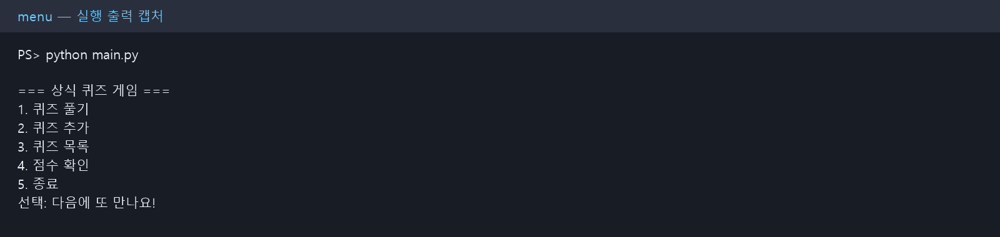

### 퀴즈 추가와 목록

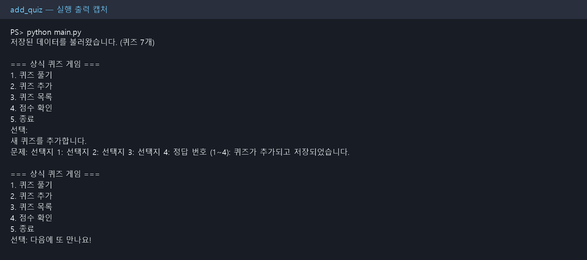

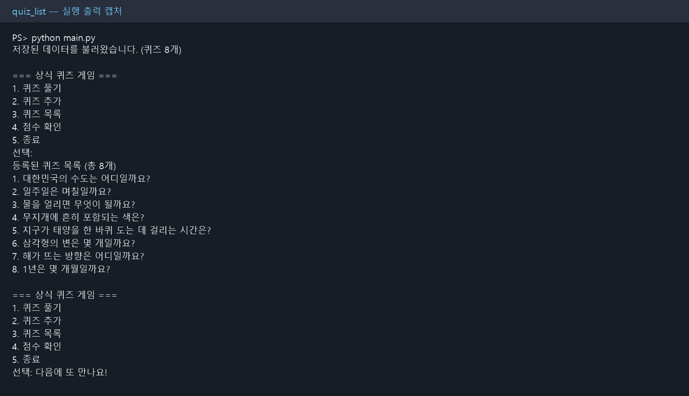

### 퀴즈 풀기와 최고 점수

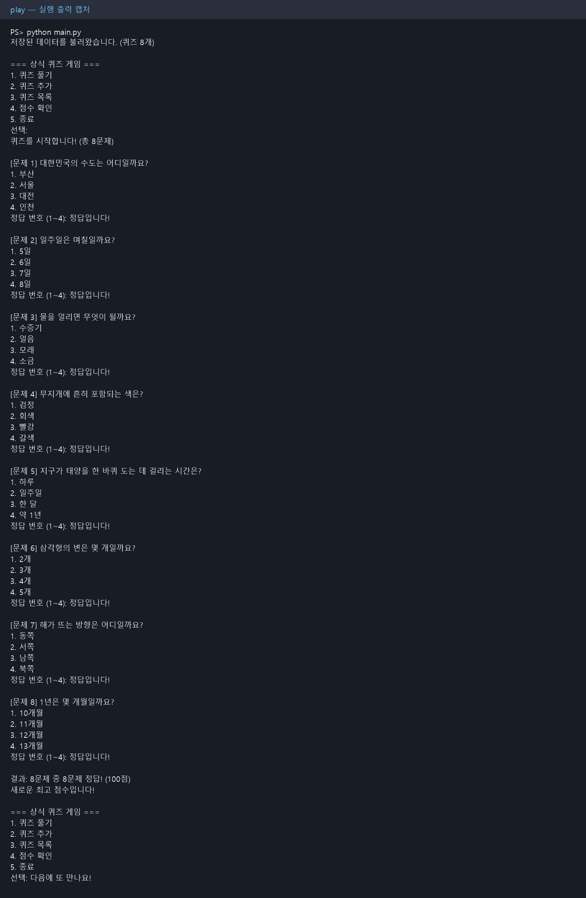

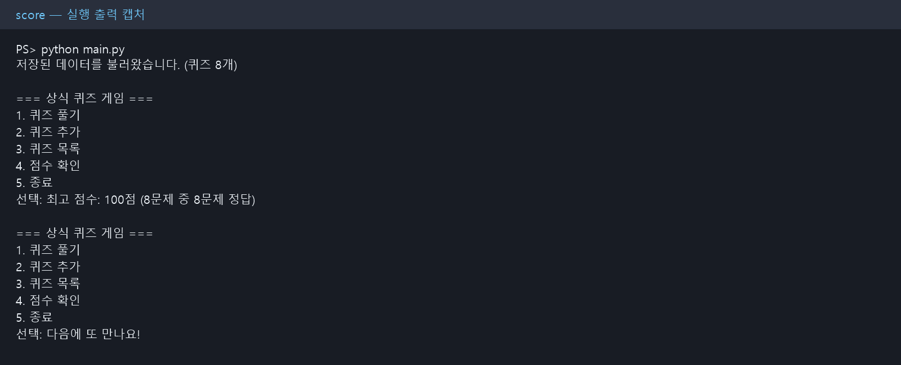

### 잘못된 입력 처리

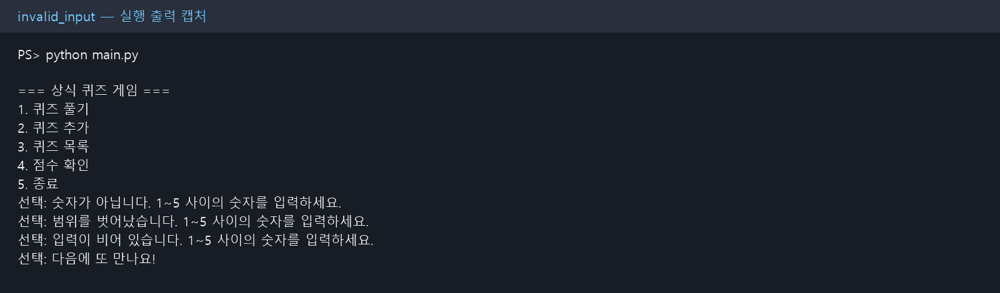

## 개발 환경과 Git 기록

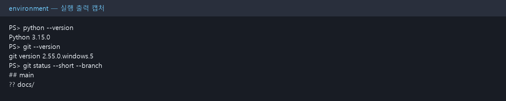

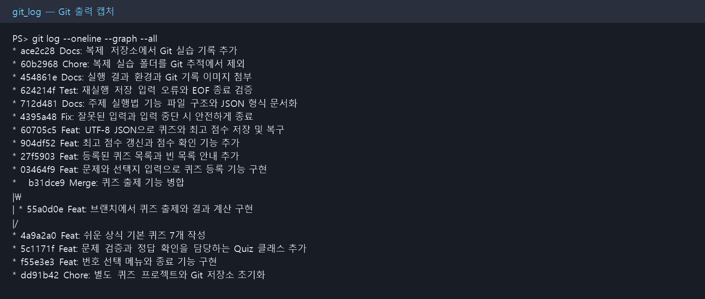

원격 `main`의 커밋 수와 이력을 확인한 [원본 로그](docs/evidence/remote_history.txt):

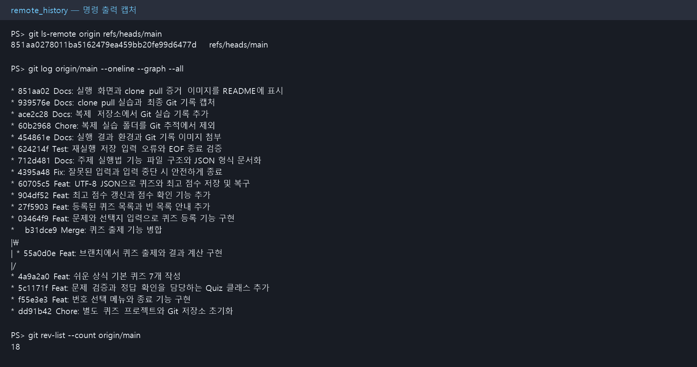

브랜치 그래프와 병합 커밋의 부모 SHA를 확인한 [원본 로그](docs/evidence/branch_merge.txt):

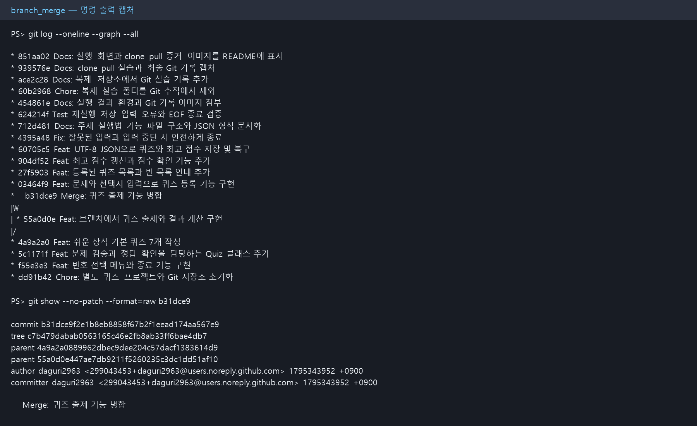

## Git 복제 실습

원본 저장소의 `pull --ff-only` 기록과 복제본의 `clone` 기록:

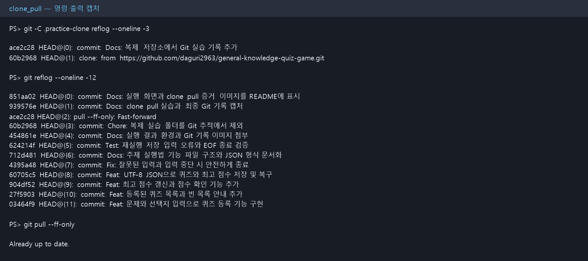

[clone·pull 원본 명령 로그](docs/evidence/clone_pull.txt)
